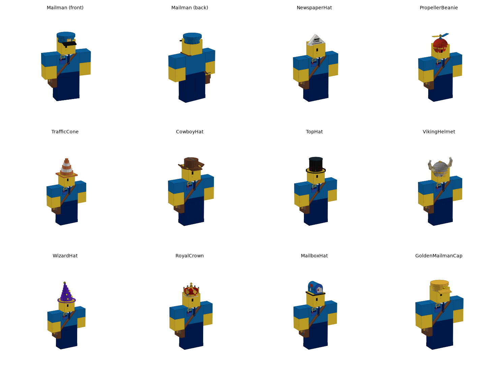
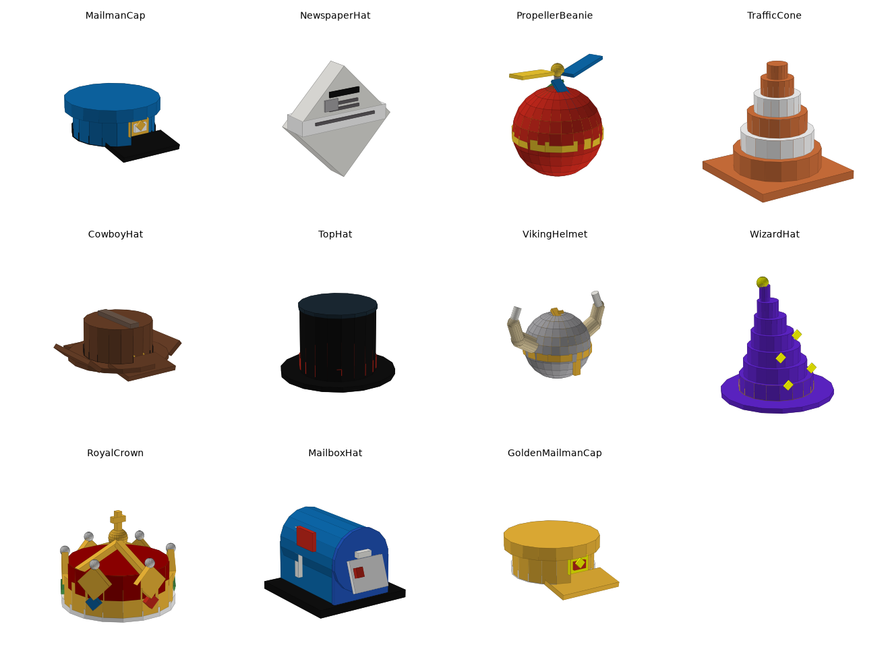
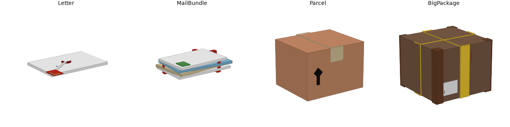
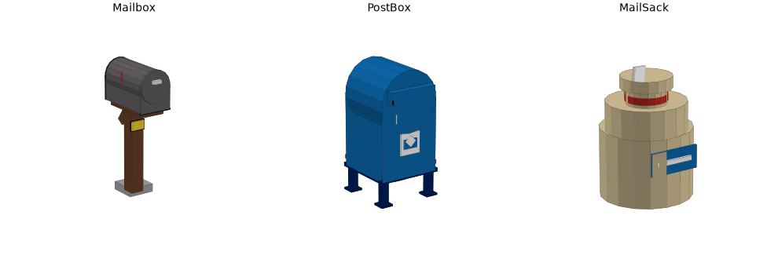
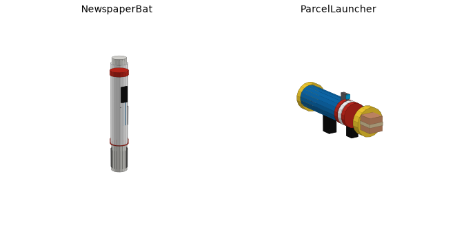

# Mailman Delivery (untitled)

A retro (2019-style) Roblox game where you play a mailman delivering mail to houses.
This repo is a [Rojo](https://rojo.space) project: it syncs straight into your place in Roblox Studio.

**Step 1 (done): models + mailman StarterCharacter.** Next up: parkour and movement, then delivery, shop and UI.



## Getting it into Studio

1. Install Rojo: the Studio plugin and the CLI (`rokit install` uses the versions pinned in `rokit.toml`).
2. In this folder run `rojo serve`, then press **Connect** in the Rojo plugin in Studio.
   Or build a place file with `rojo build -o MailmanDelivery.rbxl`.
3. Press **Play**. You spawn as the mailman.

Rojo only manages the folders listed below. Anything else in your place (your animation folder,
your map, and so on) is left alone.

## Where everything lives

```
ReplicatedStorage
├── Shared
│   ├── Config            <- tweak the game here
│   │   ├── MailmanConfig     rig type, body colours, clothing, uniform, starting hat, respawn time
│   │   ├── AnimationConfig   where your animation folder is + which names map to run/walk/idle...
│   │   ├── HatConfig         every hat: price, rarity, boosts, upgrade levels/costs
│   │   ├── MailConfig        mail types: payout, XP, bag space, spawn chance
│   │   └── WeaponConfig      weapon stats (disabled for now)
│   └── Util              AssetUtil, WeldUtil, AccessoryUtil helper modules
└── Assets                <- all models (.rbxmx)
    ├── Accessories       MailSatchel, NameBadge, MailmanTie
    ├── Hats              11 hats (MailmanCap ... GoldenMailmanCap)
    ├── Mail              Letter, MailBundle, Parcel, BigPackage
    ├── Props             Mailbox, PostBox, MailSack
    └── Weapons           NewspaperBat, ParcelLauncher (Tools)
ServerScriptService
└── Server
    ├── Main              boots the services below in order
    └── Services
        ├── AssetPrepService   welds hats/uniform/weapons at startup, warns about config/model mismatches
        ├── AnimationService   puts your animations into every character
        ├── HatService         equipped hat + boosts (player attributes)
        └── CharacterService   builds the mailman StarterCharacter, spawns/respawns players
```

Source: `src/` mirrors the tree above. Mapping: `default.project.json`.

## The mailman (StarterCharacter)

At server start `CharacterService` builds `StarterPlayer.StarterCharacter`. It's a classic blocky
R15 body (yellow skin, blue shirt, navy trousers) wearing the satchel, badge, tie and the
**Mailman Cap**. Change any of this in `MailmanConfig`.

- **Shirt/Pants textures:** `assets/clothing/MailmanShirt.png` and `MailmanPants.png` are standard
  585×559 templates (pockets, buttons, envelope logo, shoulder patches, belt, stripes, shoes).
  Upload them in Studio (Asset Manager → Bulk Import), copy each **image** id, and paste them into
  `MailmanConfig.Clothing` as `"rbxassetid://<id>"`.
- **Using your own hand-made StarterCharacter:** set `MailmanConfig.BuildStarterCharacter = false`
  and put your model in StarterPlayer.

## Animations (your folder)

`AnimationService` finds your animation folder automatically. It looks for a folder named
`Animations`, `Anims` or `Animation` in ReplicatedStorage, then ServerStorage, StarterPlayer and
Workspace. It then matches Animation objects by name (case-insensitive, subfolders are fine):

| Slot | Names it looks for |
|---|---|
| run | Run, Running, RunAnim, RunAnimation, Sprint |
| walk | Walk, Walking, WalkAnim (if missing, the **run** animation is used, so the mailman always runs) |
| idle / jump / fall / climb / swim / sit | Idle, Jump, Fall, Climb, Swim, Sit (+ "…Anim" variants) |

When you update animations, replace the Animation objects (or their AnimationId) in your folder and
keep the names. They apply on the next spawn, with no code changes. The Output window prints which
slots were found. Two things to check:

- **Rig type must match.** `MailmanConfig.RigType` defaults to **R15**. If your animations are R6, set it to R6.
- Animations must be owned by you or the group that owns the game.

## Hats & boosts

`HatConfig` holds all 11 hats, from Starter up to Mythic. Each hat has a price, base boosts
(`Speed`, `Jump`, `Cash`, `XP`) and 5 upgrade levels (each level adds 25% of the base boost).
Upgrade cost grows ×1.6 per level. `HatService` writes the final numbers to player attributes
(`EquippedHat`, `EquippedHatLevel`, `HatBoost_Speed`, `HatBoost_Cash`, …) so movement, delivery
and UI scripts can read them.

**Try hats now:** in Play mode switch to the Server view, select your Player, and change the
`EquippedHat` attribute (e.g. `TopHat`). The hat swaps instantly.

**Add a hat:** drop an Accessory (Handle with a `HatAttachment`) into `Assets/Hats`, then add an
entry with the same name in `HatConfig.Hats`.

| Hat | Rarity | Price | Boosts |
|---|---|---|---|
| Mailman Cap | Starter | free | +5% cash |
| Newspaper Hat | Common | 250 | +10% XP |
| Propeller Beanie | Common | 400 | +8% jump |
| Traffic Cone | Uncommon | 1,200 | +6% speed |
| Rodeo Courier | Uncommon | 1,800 | +4% speed, +6% cash |
| Postmaster's Top Hat | Rare | 5,000 | +20% cash |
| Viking Helmet | Rare | 6,500 | +12% jump, +5% speed |
| Stamp Wizard | Epic | 15,000 | +25% XP, +10% jump |
| Royal Mail Crown | Epic | 25,000 | +30% cash, +10% XP |
| Mailbox Head | Legendary | 60,000 | +35% cash, +10% speed, +15% XP |
| Golden Mailman Cap | Mythic | 150,000 | +50% cash, +15% speed, +15% jump, +25% XP |



## Mail, mailboxes, weapons





- **Mailbox:** pivot is at ground level (`PrimaryPart` = invisible `Root`), so `mailbox:PivotTo(CFrame.new(pos))`
  places it on the ground. It has a `Door`, a `Flag` + `FlagPole` (hinge attachment `FlagHinge`), a
  `NumberPlate`, `PromptAttachment`/`DeliveryPoint` attachments and an invisible `DeliveryZone`.
  Attributes: `HouseNumber`, `FlagUp`.
- **PostBox:** the blue pickup box at the depot (`IsPickup = true`). **MailSack** is a decoration.
- **Mail** models have a `Handle` PrimaryPart and a `MailType` attribute, ready to become carryable.
- **Weapons:** `NewspaperBat` ("The Daily Whack", has a `Hitbox` part) and `ParcelLauncher`
  (has a `Muzzle` attachment). They're Tools with the grip set up. Combat comes later.

## Editing models

All parts in the `.rbxmx` files are anchored and unwelded. `AssetPrepService` welds them at
runtime, so you can move or add parts freely.

- **In Studio:** edit the model, then right-click → *Save to File…* over the matching
  `.rbxmx` in `src/ReplicatedStorage/Assets/...` (Rojo then keeps it in sync).
- **From code:** every model is generated by `tools/modelgen` (Python). Edit
  `tools/modelgen/models/*.py` and run `python3 tools/modelgen/build.py`. That rewrites the
  `.rbxmx` files, the clothing PNGs and the preview images in `docs/previews`.
  Running it overwrites edits made in Studio, so use one workflow per model.
